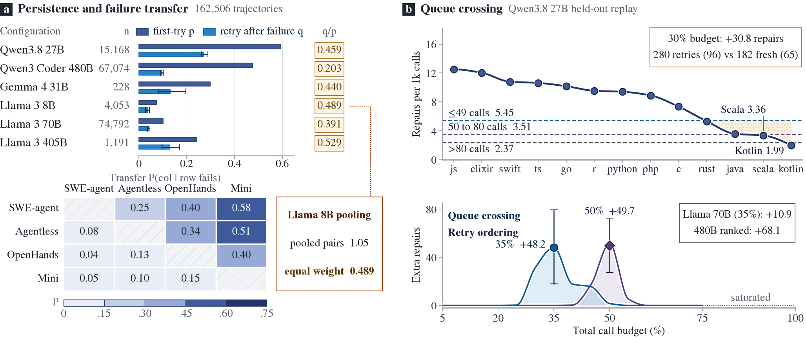
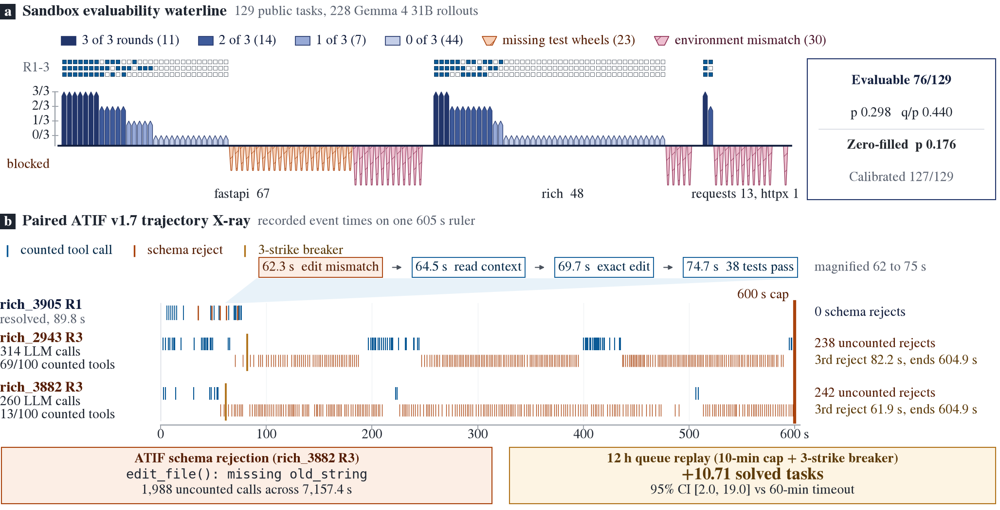
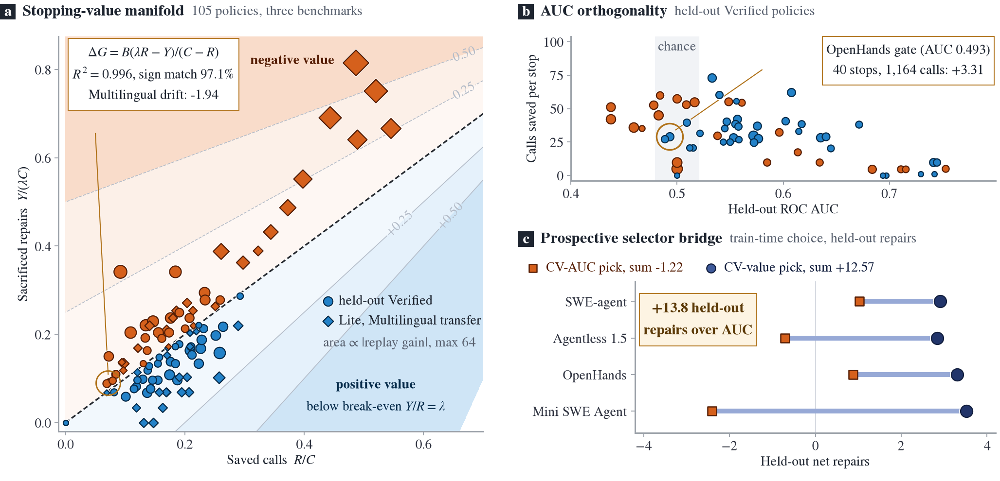

# Move On Until the Next Issue Is Worse

**Test-time compute allocation, endogenous retry crossing, and runtime stopping value for open-weight Gemma 4 coding agents**

**Author:** Yan Su (`hi@yansu.me`)

[**Paper PDF (6 pages, A4)**](paper/gemma4_queue_value_paper.pdf) | [**5-Second Verification Notebook (`reproduce.ipynb`)**](paper/reproduce.ipynb) | [**Manuscript Source (`writeup.md`)**](paper/writeup.md) | [**Analysis & Build Guide**](analysis/README.md)

## Abstract

Deployed coding agents serve finite issue queues under shared budgets, where every retry displaces an unattempted issue. Across six open and frontier configurations spanning `162,506` trajectories, one failure cuts next-attempt success to `0.203` to `0.529` of equal-issue base rate. Breadth-first scheduling repairs `43.2%` to `78.9%` more issues than immediate retries at `30%` call budget and adds `816` repairs across `5,056` Qwen3.8-27B tasks. Without verifiers, low-cost first failures overtake weak fresh tail tasks for `+30.8` held-out repairs (`95% CI 5.2 to 56.8`) at `30%` budget and `+48.2` at `35%`. An independent `67,074`-trajectory Qwen3-Coder-480B corpus adds `68.1` held-out repairs under repository-ranked breadth and withholds retries when conditional yield falls to `0.203`. Replaying `228` Gemma 4 31B A100 trajectories reproduces a `70.1%` breadth gain, separates `76` default-passing from `53` container-blocked tasks, and exposes `1,988` unmetered schema-rejected edit calls across `7,157.4` seconds. Finally, a closed-form fluid-queue stopping-value identity predicts finite-queue replay with $R^2 = 0.996$ across `105` settings, whereas ROC AUC selection forfeits `13.8` held-out repairs across four systems.

## Four Empirical Laws & Vector Plates

### 1. Persistent Difficulty & Endogenous Queue Crossing (`162,506` Trajectories)

Across six model configurations, a failed attempt cuts next-attempt success to $q/p \in [0.203, 0.529]$ under equal issue weighting, while naive pair pooling on adaptive logs inflates `Llama 3 8B` from `0.489` to `1.05`. Once repository-ranked breadth clears high-yield codebases, first-failure call-cost terciles (`<=49` calls yielding `5.45` repairs per `1,000` calls) overtake low-yield fresh tail repositories (`Kotlin 1.99`, `Scala 3.36`), adding `+30.8` held-out repairs at `30%` budget and `+48.2` at `35%` without external verifiers.



### 2. Gemma 4 31B Sandbox Waterline & ATIF v1.7 Trajectory X-Ray (`228` Rollouts)

Auditing all `129` public benchmark tasks separates `76` default-passing tasks (`p = 0.298`, `q/p = 0.440`) from `53` container-blocked tasks (`23` missing `inline_snapshot` or `dirty_equals` wheels; `30` needing per-task environment calibration), preventing zero-imputed denominator distortion (`p = 0.176`). Across `228` Gemma 4 31B A100 trajectories, truncated `edit_file` calls missing `old_string` trigger `1,988` unmetered schema rejections across `7,157.4` seconds of preceding intervals (`238` uncounted rejects in `rich_2943` R3 and `242` in `rich_3882` R3). Pairing a `10`-minute (`600s`) cap with a `3`-strike schema breaker and `5`-identical-call breaker recovers `+10.71` solved tasks (`95% CI 2.0 to 19.0`) over `12`-hour queues.



### 3. Fluid-Queue Stopping-Value Manifold & ROC AUC Orthogonality (`105` Settings)

For a queue with total cost $C$, baseline repairs $T$, shadow price $\lambda = T/C$, saved calls $R$, and sacrificed repairs $Y$, net repair gain at budget $B$ follows the closed-form identity $\Delta G = B(\lambda R - Y)/(C - R)$, matching `1,000`-order finite-queue replay with $R^2 = 0.996$ (`MAE = 0.148` vs `1.643` for naive linear $B(\lambda R - Y)/C$). Because ROC AUC ignores saved cost $R$, selecting runtime monitors by training $\Delta G$ beats cross-validated ROC AUC selection by `+13.8` held-out repairs across four agent systems (`OpenHands` step-5 gate: `Held-out AUC = 0.493`, yet `40` stops save `1,164` calls and add `+3.31` net repairs).



## Summary of Headline Results

| Dimension | Corpus / System Scope | Core Finding | Held-Out / Replay Gain |
|:--|:--|:--|:--|
| **Breadth vs. Immediate Retry** | `5,056` Qwen3.8-27B / `6,282` Qwen3-Coder-480B / `76` Gemma 4 31B tasks | Equal-issue $q/p \in [0.203, 0.529]$; breadth beats retry-first at `30%` budget | `+43.2%` to `+78.9%` (`+816` Qwen3.8 repairs) |
| **Endogenous Queue Crossing** | `2,464` held-out Qwen3.8-27B / `3,151` held-out Qwen3-Coder-480B tasks | Cheap first failures (`<=49` calls) overtake weak fresh tail repos; `480B` abstains at $q/p = 0.203$ | `+30.8` at `30%`, `+48.2` at `35%` (`+68.1` ranked breadth on `480B`) |
| **Gemma 4 Sandbox & Breakers** | `129` public reference checks + `228` Gemma 4 31B A100 ATIF v1.7 rollouts | `76/129` default-evaluable; `1,988` unmetered `edit_file` schema rejects across `7,157.4s` | `+10.71` solved tasks (`600s` cap + `3`-strike schema breaker) |
| **Stopping-Value Identity $\Delta G$** | `105` policies across `4` systems on Verified (`465`), Lite (`192`), Multilingual (`300`) | $\Delta G = B(\lambda R - Y)/(C - R)$ achieves $R^2 = 0.996$, `97.1%` sign match | `+13.8` held-out repairs over CV ROC AUC selection |

## 5-Second Verification & Full Reproduction

Install the lightweight verification packages and run [`paper/reproduce.ipynb`](paper/reproduce.ipynb) or the standalone table and confirmation scripts (executes in `< 2` seconds, verifying all `158/158` numeric table cells and all `3` vector plates):

```sh
python3 -m pip install -r analysis/requirements-confirmation.txt matplotlib Pillow
python3 analysis/reproduce_confirmation.py
python3 analysis/publication_tables.py
```

To regenerate the three vector plates (`paper/figures/fig1..3.pdf`) and compile the 6-page PDF (`paper/gemma4_queue_value_paper.pdf`) with end-to-end SHA-256 verification:

```sh
python3 analysis/build_publication_figures.py
python3 analysis/build_paper_pdf.py
python3 analysis/verify_paper_pdf.py
```

## Repository Contents

* [`paper/gemma4_queue_value_paper.pdf`](paper/gemma4_queue_value_paper.pdf): Compiled 6-page A4 paper with embedded vector plates and zero metadata residue.
* [`paper/reproduce.ipynb`](paper/reproduce.ipynb): Self-contained 5-second verification notebook checking all four tables (`158` numeric cells) and displaying the three vector figures.
* [`paper/writeup.md`](paper/writeup.md) & [`paper/gemma4_queue_value_paper.tex`](paper/gemma4_queue_value_paper.tex): Locked Markdown manuscript and synchronized LaTeX source.
* [`paper/figures/`](paper/figures/): Vector plates (`fig1..3.pdf`), high-resolution previews (`fig1..3.png`), and SHA-256 provenance receipt ([`publication_figures_provenance.json`](paper/figures/publication_figures_provenance.json)).
* [`analysis/`](analysis/): Reproducible evaluation, table verification, figure generation, and PDF build scripts (see [`analysis/README.md`](analysis/README.md)).
* [`evidence/`](evidence/): Frozen compact ledgers ([`evidence/results/`](evidence/results/)), `228` Gemma 4 31B A100 rollouts and `129`-task sandbox audit ([`evidence/gemma_a100/`](evidence/gemma_a100/)), and runtime prefix tables ([`evidence/data/`](evidence/data/)).
