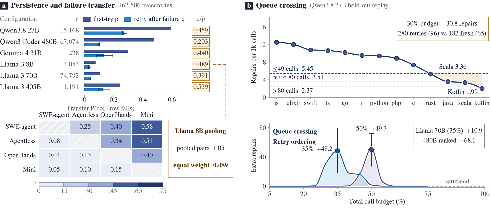
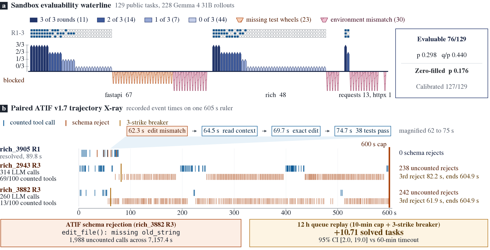
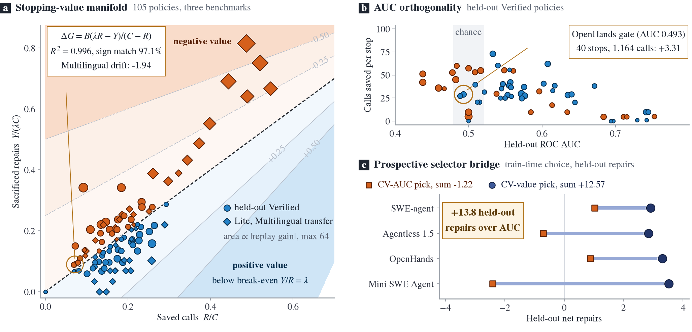

# Move On Until the Next Issue Is Worse

**Test-time compute allocation, endogenous retry crossing, and runtime stopping value for open-weight Gemma 4 coding agents**

**Keywords:** language model agents, software engineering, test-time compute, agent evaluation, code benchmark, early stopping

## Abstract

Deployed coding agents serve finite issue queues under shared budgets, where every retry displaces an unattempted issue. Across six configurations spanning 162,506 trajectories, one failure cuts next-attempt success to 0.203 to 0.529 of equal-issue base rate. Breadth-first scheduling repairs 43.2% to 78.9% more issues than immediate retries at 30% call budget and adds 816 repairs across 5,056 Qwen3.8-27B tasks. Without verifiers, low-cost first failures overtake weak fresh tail tasks for +30.8 held-out repairs at 30% budget (95% CI 5.2 to 56.8) and +48.2 at 35%. An independent 67,074-trajectory Qwen3-Coder-480B corpus adds 68.1 held-out repairs under repository-ranked breadth and withholds retries when conditional yield falls to 0.203. Replaying 228 Gemma 4 31B A100 trajectories reproduces a 70.1% breadth gain, separates 76 default-passing from 53 blocked tasks, and exposes 1,988 unmetered schema-rejected edit calls across 7,157.4 seconds. Finally, a closed-form fluid-queue stopping-value identity predicts finite-queue replay with R² = 0.996 across 105 settings, whereas ROC AUC selection forfeits 13.8 held-out repairs across four systems. All ledgers, ATIF diagnostics, and reproduction scripts are open.

## 1. Finite queues change the economics of agent compute

Open-weight models such as Gemma 4 31B IT QAT bring autonomous software repair onto single-accelerator sandboxes (Gemma Team et al., 2026). Standard benchmarks score inference one bug at a time through repeated sampling or extended test-time scaling (Jimenez et al., 2024; Brown et al., 2024; Snell et al., 2024; Muennighoff et al., 2025; DeepSeek-AI et al., 2025). Live repositories and the competition harness impose a serial queue within one shared 12-hour session (Markowitz et al., 2026). Per-issue ceilings of 60 minutes, 100 counted tools, and 500 turns cannot protect throughput once twelve hour-long runs exhaust the clock.

Shared queues shift the objective from single-issue resolution to opportunity cost per unit of compute. Recent studies examine warm restarts with retained patches (Wang et al., 2026), within-issue rollout variance (Srinivasan et al., 2026), uniform-cost allocation (Bae, 2026), and abstraction-guided token control (Sepidband et al., 2026). Parallel work advances schema-invariant graph learning (Markowitz et al., 2025; Stoll et al., 2025; Finkelshtein et al., 2026) and competition-grade evaluation rigor over noisy micro-benchmarks (Sculley et al., 2025; Yauney et al., 2026). Auditing 162,506 trajectories across OpenHands (Wang et al., 2025), SWE-agent (Yang et al., 2024), Agentless (Xia et al., 2024), and Gemma 4 shows how heterogeneous costs and cross-issue reallocation overturn single-issue heuristics:

1. *Persistence collapse:* One failure cuts next-attempt success to 0.203 to 0.529 of the equal-issue base rate across six models, whereas attempt-weighted pooling inflates this ratio above 1.0.
2. *Endogenous queue crossing:* Uniform-cost allocation needs strong priors to beat round-robin (Bae, 2026), yet cheap first failures overtake weak fresh tasks for +30.8 held-out repairs at 30% budget while abstaining at $q/p = 0.203$.
3. *Evaluability waterline and schema burn:* Auditing 129 public tasks and 228 Gemma 4 31B runs separates 76 default-passing tasks from 53 container-blocked tasks and exposes 1,988 unmetered `edit_file` rejections across 7,157.4 seconds.
4. *Fluid-queue stopping value:* Within-issue monitors hover near 0.50 ROC AUC under fixed single-issue budgets (Srinivasan et al., 2026), yet queue reallocation obeys a closed-form identity with R² = 0.996 and beats AUC selection by +13.8 repairs.

*Figure 1. **Persistent difficulty ($q/p \le 0.529$) and endogenous queue crossing across 162,506 trajectories.** (a) Equal-issue ratios $q/p$ versus pooling bias across six models, paired with 4×4 cross-system failure transfer on 465 shared issues. (b) Fresh-queue yield decay versus first-failure call terciles on Qwen3.8-27B (+48.2 peak at 35% budget) and Qwen3-Coder-480B abstention.*

## 2. Repetition does not erase issue difficulty

Let $p$ denote the success probability of an attempt drawn with equal issue weight, and let $q$ denote another attempt's success probability after one failure on the same issue. For exchangeable binary attempts with within-issue correlation $\rho$,

$$q = p(1 - \rho).$$

Positive correlation concentrates failures onto persistent difficulties. Even with a fresh random seed, any cold retry enters at reduced conditional probability against an untouched queue draw.

Three seeded Qwen3.8-27B OpenHands rollouts span 5,056 SWE-rebench V2 tasks (Badertdinov et al., 2026) at temperature 1.0 and a 1-hour cap after filtering 1,191 zero-rollout and 25 partial entries from 6,272 overlay tasks. Rollout pass rates of 0.590, 0.601, and 0.591 give base rate $p = 0.594$, retry rate $q = 0.273$, and $q/p = 0.459$ (95% CI 0.442-0.476, ANOVA ICC 0.541). Unsolved tasks (1,240 of 5,056) absorb 60.5% of failures, and a beta-binomial fit predicts pass@3 of 0.757 versus 0.755 observed.

Asymmetric execution costs steepen this drop. Successful Qwen3.8-27B runs average 57.5 calls and 667 seconds; failed runs average 84.8 calls and 1,097 seconds. Fresh issues return 8.67 repairs per 1,000 calls against 3.43 on retry. Per-call yield falls to 0.396 of fresh yield, and per-hour yield falls to 0.382.

**Table 1. Persistent issue difficulty across six model configurations (162,506 trajectories, equal issue weighting).**

| Model and scaffold | Trajectories | Issues | Base $p$ | Retry $q$ | Ratio $q/p$ | 95% CI |
|:--|--:|--:|--:|--:|--:|--:|
| Qwen3.8-27B, OpenHands | 15,168 | 5,056 | 0.594 | 0.273 | 0.459 | 0.442-0.476 |
| Qwen3-Coder-480B-A35B, OpenHands | 67,074 | 6,282 | 0.476 | 0.096 | 0.203 | 0.194-0.211 |
| Gemma 4 31B IT QAT, competition | 228 | 76 | 0.298 | 0.131 | 0.440 | 0.294-0.592 |
| Llama 3 8B, SWE-agent | 4,053 | 526 | 0.074 | 0.036 | 0.489 | 0.418-0.558 |
| Llama 3 70B, SWE-agent | 74,792 | 3,504 | 0.101 | 0.040 | 0.391 | 0.371-0.411 |
| Llama 3 405B, SWE-agent | 1,191 | 100 | 0.243 | 0.129 | 0.529 | 0.449-0.609 |

Public multi-attempt logs also hide an adaptive sampling trap. Llama issues receive up to 91 attempts, and easier issues draw heavier resampling. Pooling all attempt pairs weights issues by rollout count and inflates the Llama 3 8B ratio to 1.05; equal weighting across tasks with at least three attempts restores $q/p = 0.489$. An independent 67,074-trajectory Qwen3-Coder-480B corpus (6,306 total issues, 6,282 repeat-eligible) yields $p = 0.476$, $q = 0.096$, $q/p = 0.203$, and $\rho = 0.797$. Difficulty transfers across scaffolds as well. Twelve ordered pairs of four systems on 465 shared SWE-bench Verified tasks (Chowdhury et al., 2024) average 0.48 of the target base rate after another system fails, with all twelve intervals below 1.0.

### Breadth captures the first pass

Retry-first spends up to three attempts on the active issue before advancing, whereas breadth-first attempts every issue once first. Paired replay across 1,000 queue orders on Qwen3.8-27B at 30% call budget yields 2,704 breadth-first repairs versus 1,887 for retry-first (+816 repairs, +43.2%, 95% CI 723-917). Held-out replay on 3,151 Qwen3-Coder-480B tasks at 30% of `assistant_calls` repairs 1,361.5 issues versus 761.2 for retry-first (+600.3 repairs, +78.9%, 95% CI 551.0-650.0). Wall-time replay on Gemma 4 31B at 30% budget repairs 20.3 issues versus 11.9 for retry-first (+8.3 repairs, +70.1%, 95% CI 1.0-17.0). Breadth dominates the opening pass, yet exhausting every fresh task first assumes the weakest unattempted issue still beats the cheapest failure.

## 3. Breadth wins until the next issue is worse

Ranking fresh issues by repository prior clears productive codebases early and leaves harder repositories at the queue tail. Once fresh tail yield drops low enough, a fast retry on a brief failure can return more repairs per call than the next unattempted issue. Our greedy marginal-yield scheduler estimates expected repairs per call $\hat{y}_a / \hat{c}_a$ on training data across fresh tasks, first retries, and second retries, then dispatches the highest-yield candidate next.

We fit fresh yield by repository language and retry yield by language, failed-attempt call tercile, and failure count on 2,592 Qwen3.8-27B training tasks, then evaluate across 250 paired orders on 2,464 held-out tasks. Without external verifiers, sandbox exit status and first-failure calls separate cheap slips from intractable bugs. Failures using at most 49 calls yield 5.45 repairs per 1,000 calls on retry, exceeding fresh Kotlin (1.99) and Scala (3.36). Three policies share identical fresh ordering. **Ranked breadth** exhausts fresh tasks before unranked retries, **Deferred control** ranks retries after fresh tasks finish, and **Adaptive** lets higher-yield retries overtake weak fresh tasks. Adaptive minus Deferred control isolates queue crossing; Deferred control minus Ranked breadth isolates retry ordering.

**Table 2. Paired held-out queue scheduling replay across Qwen3.8-27B and Qwen3-Coder-480B confirmation.**

| Corpus and budget | Plain breadth | Ranked breadth | Deferred control | Adaptive | Ordering gain | Crossing gain | Total gain vs plain |
|:--|--:|--:|--:|--:|--:|--:|--:|
| Qwen3.8-27B, 30% | 1,314.0 | 1,418.4 | 1,418.4 | 1,449.3 | 0.0 [0.0, 0.0] | +30.8 [5.2, 56.8] | +135.3 [90.2, 181.8] |
| Qwen3.8-27B, 40% | 1,577.2 | 1,641.8 | 1,642.0 | 1,660.6 | +0.2 [0.0, 4.8] | +18.6 [−1.8, 36.0] | +83.3 [55.2, 110.0] |
| Qwen3.8-27B, 50% | 1,744.3 | 1,752.5 | 1,802.2 | 1,804.8 | +49.7 [27.2, 72.0] | +2.6 [−4.8, 16.8] | +60.6 [37.0, 82.0] |
| Qwen3-Coder-480B, 20% | 907.1 | 976.2 | 976.2 | 976.2 | 0.0 [0.0, 0.0] | 0.0 [0.0, 0.0] | +69.1 [38.0, 105.0] |
| Qwen3-Coder-480B, 30% | 1,361.5 | 1,429.5 | 1,429.5 | 1,429.5 | 0.0 [0.0, 0.0] | 0.0 [0.0, 0.0] | +68.1 [46.0, 93.0] |
| Qwen3-Coder-480B, 50% | 1,654.6 | 1,661.9 | 1,661.2 | 1,661.2 | −0.7 [−4.0, 3.0] | 0.0 [0.0, 0.0] | +6.5 [−4.0, 16.0] |

At 30% Qwen3.8-27B budget, 280 early retries across four dynamic languages solve 96 issues while displacing 182 fresh Rust and Java runs worth 65 repairs. Queue crossing nets +30.8 held-out repairs (95% CI +5.2 to +56.8). On a 5% budget grid, crossing peaks at 35% budget (+48.2 repairs, 18.0 to 79.6) while retry ordering peaks at 50% (+49.7 repairs, 27.2 to 72.0). Llama 3 70B message-budget replay reproduces the 35% crossing peak at +10.9 repairs (2.7 to 20.0).

Confirmation on the 67,074-trajectory Qwen3-Coder-480B corpus covers 6,264 three-attempt tasks from the 6,282 repeat-eligible issues in Table 1 after excluding 18 two-attempt tasks (3,113 training, 3,151 held-out). At $q/p = 0.203$, first-retry training yields of 0.73 to 2.60 repairs per 1,000 `assistant_calls` stay below the hardest fresh repositories at 3.40 to 10.36. Our scheduler abstains from early crossing at 20% to 40% budgets with 0.0 loss, while repository-ranked breadth adds +69.1 repairs at 20% budget and +68.1 at 30%. At 50% budget, short non-empty failures ranked ahead of long or empty-patch failures add +16.6 repairs (−10.0 to +44.0). Marginal-yield scheduling still trusts the harness meter to price wall-clock expenditure.

## 4. A tool budget can hide an expensive failure

What happens when the harness meter goes blind or the container rejects valid patches? Prior work links agent failures to specification drift, brittle reproduction tests, and action loops (Cemri et al., 2025; Bouzenia & Pradel, 2025; Filippelli et al., 2026). In early stopping and agent evaluation across code benchmarks, we audited all 129 public tasks and recorded 228 trajectories across 76 evaluable tasks (three rollouts each) using Gemma 4 31B IT QAT w4a16 on an A100 80GB GPU. Runs used vLLM 0.19.1, 32K context, temperature 1.0, top-k 64, 100 counted tools, and a 600s cap inside the 60-minute harness limit.

Running reference patches in the default public container (`vllm-openai:v0.19.1` Python 3.12 subprocess with mounted wheelhouse) passes 76 of 129 tasks and blocks 53. Blocked tasks span 36 of 67 in `fastapi`, 11 of 13 in `requests`, 5 of 48 in `rich`, and 1 of 1 in `httpx`. Missing `inline_snapshot` (17) or `dirty_equals` (6) wheels halt 23 tasks. Supplying both recovers 21 (leaving 2 proxy and recursion limits), and per-task Python, async-plugin, or certificate alignment recovers 30 to reach 127 of 129 (76+21+30), while hosts confirm 100% private gold pass.

Isolating the 76 default-passing tasks avoids denominator bias. Zero-imputing the 53 blocked tasks depresses $p$ from 0.298 to 0.176 and $q/p$ from 0.440 to 0.375.

**Table 3. Gemma 4 31B sandbox reference audit (129 tasks) and ATIF trajectory accounting (228 attempts on 76 tasks).**

| Audit dimension / failure modality | Exposed wins (of 68) | Exposed losses (of 160) | Total events / tasks | Restart rate $q$ | 95% CI / exact test |
|:--|--:|--:|--:|--:|:--|
| Reference patch passes in default sandbox | n/a | n/a | 76 / 129 tasks | 0.131 | 0.080-0.193 |
| Reference fails: missing `inline_snapshot` / `dirty_equals` | n/a | n/a | 23 / 129 tasks | n/a | Unsolvable in default wheels |
| Reference fails: per-task env / async / cert calibration | n/a | n/a | 30 / 129 tasks | n/a | Excluded from denominator |
| Any `edit_file` tool error | 21 | 76 | 97 attempts | 0.164 | 0.086-0.267 |
| Schema-rejected `edit_file` (missing `old_string`) | 12 | 38 | 1,988 calls | 0.197 | 0.081-0.353 |
| Non-schema `edit_file` string mismatch | 13 | 53 | 66 attempts | 0.123 | 0.045-0.216 |
| Wall-clock timeout at 600s cap | 0 | 28 | 28 attempts | 0.196 | 0.068-0.370 |
| Context-window overflow (32K limit) | 0 | 12 | 12 attempts | 0.083 | 0.000-0.300 |
| Early action loop flag | 4 | 15 | 19 attempts | 0.300 | 0.100-0.563 |
| Exact $\ge 5$ consecutive identical tool calls | 0 | 9 | 13 paired tasks | n/a | Sign test $p = 0.00391$ |

Gemma 4 solves 68 of 228 attempts across 32 tasks (11 solved in three rollouts, 14 in two, 7 in one, and 44 in zero). Forum reports noted isolated `old_string` parser rejections that left `tool_calls_used` unchanged. Full ATIF v1.7 accounting across 15,861 LLM requests and 12,238 counted tools establishes systemic scale. Gemma 4 triggers **1,988 unmetered schema-rejected `edit_file` requests** across 12 wins and 38 losses over 7,157.4 seconds of preceding gaps. Whenever truncated output omits `old_string`, the harness returns a schema error without advancing the 100-tool counter. Round 3 of `rich_2943` fires 314 LLM calls and 238 rejections against 69 counted tools over 604.9s; round 3 of `rich_3882` fires 260 LLM calls and 242 rejections against 13 counted tools over 604.9s. Across 13 tasks with both wins and losses, five or more identical consecutive calls occur in 9 failed and 0 successful runs (sign test $p = 0.00391$). Resolved runs average 213.3s (median 174.2s, 95th percentile 508.3s), whereas uncapped loops burn to the 60-minute limit. Pairing a 10-minute (600s) cap with 3-strike schema and 5-identical-call breakers recovers +10.71 tasks (2.0 to 19.0) at zero late recovery, +9.04 (1.0 to 18.0) at 25%, and +3.97 even at 100% recovery. Syntactic breakers stop parser loops; whether learned prefix gates can halt semantically doomed runs when within-issue discrimination stays near chance requires a value law.

*Figure 2. **Gemma 4 31B sandbox waterline and ATIF v1.7 trajectory X-ray.** (a) Evaluability waterline across 129 public tasks separating 76 default-passing tasks from 53 container-blocked tasks. (b) Paired ATIF X-ray contrasting healthy recovery (`rich_3905` R1) against `rich_2943` R3 (238 unmetered schema rejections) and `rich_3882` R3 (242 rejections) burning to the 600s cap.*

## 5. A better classifier can choose a worse stop

Consider a queue whose full trajectories incur cost $C$, repair $T$ issues, and clear work at shadow price $\lambda = T/C$. A runtime stopping gate frees $R$ calls while sacrificing $Y$ eventual repairs. Under a fluid-queue model at budget $B$, net repair gain equals

$$\Delta G = \frac{B(\lambda R - Y)}{C - R}.$$

Under random queue permutation before exhaustion ($B \le C - R$), stopping straddles at most one boundary trajectory. Denominator contraction $(C - R)^{-1}$ cuts replay MAE from 1.643 repairs (linear $B(\lambda R - Y)/C$, $R^2 = 0.754$) to 0.148 ($R^2 = 0.996$). Halting increases repairs if and only if sacrificed repairs per saved call $Y/R$ stay below $\lambda$. Because ROC AUC integrates rank order without weighting saved cost $R$, two monitors with identical AUC can induce opposite signs of $\Delta G$.

We test action-prefix monitors at steps 5 to 15 across 465 SWE-bench Verified tasks (280 training, 185 held-out) on four systems, plus 192 Lite and 300 Multilingual tasks (Zan et al., 2025) totaling 105 settings. Across all 105 settings, the identity predicts 1,000-order paired replay with **R² = 0.996**, slope 1.014, mean absolute error 0.148 repairs, and 97.1% sign agreement. Held-out Verified baselines $(T, C)$ at $B = 0.5 C$ are $(52, 7,350)$ for SWE-agent, $(73, 2,759)$ for Agentless, $(101, 4,632)$ for OpenHands, and $(122, 12,271)$ for Mini SWE Agent.

**Table 4. Runtime stopping monitor selection by training decision value vs. training ROC AUC on 185 held-out Verified tasks per system ($B = 0.5 C$).**

| System | AUC-selected gain | Value-selected gain | Selected gate AUC | Stops / lost $Y$ | Saved calls $R$ | Loss rate $Y/R$ vs $\lambda$ |
|:--|--:|--:|--:|--:|--:|--:|
| SWE-agent + GPT-4o | +1.03 | +2.91 | 0.557 | 39 / 7.0 | 1,640 | 0.0043 < 0.0071 |
| Agentless 1.5 + GPT-4o | −0.71 | +2.84 | 0.741 | 38 / 5.0 | 377 | 0.0133 < 0.0265 |
| OpenHands + Claude 3.5 Sonnet | +0.88 | +3.31 | 0.493 | 40 / 20.0 | 1,164 | 0.0172 < 0.0218 |
| Mini SWE Agent + Claude 4.5 Haiku | −2.41 | +3.52 | 0.533 | 35 / 20.0 | 2,558 | 0.0078 < 0.0099 |
| **Four-system sum (pooled CI)** | **−1.22** | **+12.57** | **0.581 mean** | **152 / 52.0** | **5,739** | **+13.8 over AUC** |

Prospective selection on the 280 training tasks by cross-validated ROC AUC loses −1.22 held-out repairs across the four systems. Selecting on the identical split by training decision value $\Delta G_{\text{train}}$ gains +12.57 held-out repairs and beats AUC selection by **+13.8 held-out repairs**. Pooled joint-bootstrap value gain over unstopped runs is +12.8 repairs (95% CI +3.5 to +23.3 under order averaging and +3.6 to +23.6 under the identity). Our OpenHands step-5 gate reconciles queue stopping with Srinivasan et al. (2026): held-out ROC AUC sits at 0.493, yet 40 stops free 1,164 calls and add +3.31 repairs because $Y/R = 0.0172 < \lambda = 0.0218$. Conversely, applying the Verified-trained Mini gate to 300 Multilingual tasks raises $Y/R$ to 0.0198 above target $\lambda = 0.0157$ and loses −1.94 replayed repairs (−1.97 predicted). Pilot screening for $Y/R < \lambda$ predicts held-out sign across 73.3% of rules and blocks negative transfer.

*Figure 3. **Analytical stopping-value manifold ($\Delta G$, $R^2 = 0.996$) and the ROC AUC orthogonality paradox.** (a) Iso-value contours across 105 stopping rules separated by $Y/R = \lambda$. (b) Held-out ROC AUC versus saved calls per stop (`OpenHands` step-5 gate: `AUC = 0.493`, `+3.31` repairs) and (c) four-system prospective value versus AUC selection (`+13.8` repairs).*

## 6. Open resource suite and deployment rule

Our [open resource suite](https://github.com/logxio/gemma4-queue-value) ships four artifacts. First, `openhands_queue_restart.json` and `nebius_attempt_costs.csv` provide per-attempt cost and prefix ledgers across 162,506 trajectories. Second, `gemma4_sandbox_and_schema_audit.json` provides the 129-task sandbox audit and 228-trajectory Gemma 4 31B ATIF v1.7 ledger. Third, `decision_value.json` provides the 105-policy stopping-value benchmark. Fourth, our [reproduction notebook](https://github.com/logxio/gemma4-queue-value/blob/main/paper/reproduce.ipynb) and [analysis suite](https://github.com/logxio/gemma4-queue-value/blob/main/analysis/README.md) rebuild all tables and figures in under five seconds.

Four rules govern 12-hour queues. Verify container solvability before scoring model reasoning. Enforce a 10-minute (600s) cap with a 3-strike schema breaker and 5-identical-call breaker. Run repository-ranked breadth-first until fresh tail yield drops below low-cost retry yield, then permit queue crossing. Enable prefix stopping only after a pilot confirms $Y/R < \lambda$.

## References

1. Badertdinov, I., Nekrashevich, M., Shevtsov, A., & Golubev, A. (2026). *SWE-rebench V2: Language-Agnostic SWE Task Collection at Scale*. arXiv:2602.23866.
2. Bae, J. (2026). *Give Up to Get More: Priors, Not Policies, Govern Test-Time Compute Allocation*. arXiv:2611.06372.
3. Bouzenia, I., & Pradel, M. (2025). *Understanding Software Engineering Agents: A Study of Thought-Action-Result Trajectories*. ASE 2025. arXiv:2506.18824.
4. Brown, B., Juravsky, J., Ehrlich, R., Clark, R., Le, Q. V., Ré, C., & Mirhoseini, A. (2024). *Large Language Monkeys: Scaling Inference Compute with Repeated Sampling*. arXiv:2407.21787.
5. Cemri, M., Pan, M. Z., Yang, S., Agrawal, L. A., Chopra, B., Tiwari, R., Keutzer, K., Parameswaran, A., Klein, D., Ramchandran, K., Zaharia, M., Gonzalez, J. E., & Stoica, I. (2025). *Why Do Multi-Agent LLM Systems Fail?* NeurIPS 2025 Spotlight. arXiv:2503.13657.
6. Chowdhury, N., Aung, J., Shern, C. J., Jaffe, O., Sherburn, D., Starace, G., Mays, E., Dias, R., Aljubeh, M., Glaese, M., Jimenez, C. E., Yang, J., Ho, L., Patwardhan, T., Liu, K., & Madry, A. (2024). *SWE-bench Verified*. OpenAI.
7. DeepSeek-AI, Guo, D., Yang, D., Zhang, H., Song, J., Wang, P., Zhu, Q., Xu, R., Zhang, R., Ma, S., et al. (2025). *DeepSeek-R1: Incentivizing Reasoning Capability in LLMs via Reinforcement Learning*. Nature, 645, 633-638. arXiv:2501.12948.
8. Filippelli, L., Taherkhani, H., Pham, H. V., & Hemmati, H. (2026). *A Taxonomy of Failing Bug Reproduction Tests on SWT-Bench*. arXiv:2611.13395.
9. Finkelshtein, B., Linhares, A., Veličković, P., Perozzi, B., & Galkin, M. (2026). *The Universal Classifier for Graph Learning*. arXiv:2609.36302.
10. Gemma Team, El Abd, S., Aggarwal, V., Algayres, R., Andreev, A., Bachem, O., Ballantyne, I., Brick, C., Cărbune, V., Casbon, M., et al. (2026). *Gemma 4 Technical Report*. arXiv:2607.02770.
11. Jimenez, C. E., Yang, J., Wettig, A., Yao, S., Pei, K., Press, O., & Narasimhan, K. (2024). *SWE-bench: Can Language Models Resolve Real-World GitHub Issues?* ICLR 2024 Oral. arXiv:2310.06770.
12. Markowitz, E., Galiya, K., Ver Steeg, G., & Galstyan, A. (2025). *KG-LLM-Bench: A Scalable Benchmark for Evaluating LLM Reasoning on Textualized Knowledge Graphs*. arXiv:2504.07087.
13. Markowitz, E., Perozzi, B., Rózemberczki, B., Cameron, G., Hemmati, H., Li, Y., Galkin, M., Farhadi, M., Holbrook, R., & Oldacre, A. (2026). *Google: The Gemma 4 Developer Agent Paper Track*. Kaggle.
14. Muennighoff, N., Yang, Z., Shi, W., Li, X. L., Fei-Fei, L., Hajishirzi, H., Zettlemoyer, L., Liang, P., Candès, E., & Hashimoto, T. (2025). *s1: Simple Test-Time Scaling*. arXiv:2501.19393.
15. Sculley, D., Cukierski, W., Culliton, P., Dane, S., Demkin, M., Holbrook, R., Howard, A., Mooney, P., Reade, W., Risdal, M., & Keating, N. (2025). *Position: AI Competitions Provide the Gold Standard for Empirical Rigor in GenAI Evaluation*. arXiv:2505.00612.
16. Sepidband, M., Shin, J., Wang, S., & Hemmati, H. (2026). *FlowPlan: Reducing the Token Cost of Coding Agents with Abstraction-Guided Planning and Verification*. arXiv:2611.13241.
17. Snell, C., Lee, J., Xu, K., & Kumar, A. (2024). *Scaling LLM Test-Time Compute Optimally can be More Effective than Scaling Model Parameters*. arXiv:2408.03314.
18. Srinivasan, S., Li, L., Menzies, T., & Assunção, W. (2026). *Continue or Restart? The Limits of Early Failure Prediction in Coding Agents*. arXiv:2610.35971.
19. Stoll, T., Qian, C., Finkelshtein, B., Parviz, A., Weber, D., Frasca, F., Shavit, H., Siraudin, A., Mielke, A., Anastacio, M., Müller, E., Bechler-Speicher, M., Bronstein, M., Galkin, M., Hoos, H., Niepert, M., Perozzi, B., Tönshoff, J., & Morris, C. (2025). *GraphBench: Next-Generation Graph Learning Benchmarking*. arXiv:2512.04475.
20. Wang, C., Lyu, Y., He, J., Yang, Z., Zhong, C., Harel, Y., & Lo, D. (2026). *Fail-Fast, Restart-Smart: Early Failure Prediction and Restart for SWE Agentic Tasks*. arXiv:2608.03222.
21. Wang, X., Li, Boxuan, Song, Yufan, Xu, F. F., Tang, X., Zhuge, M., Pan, J., Song, Yueqi, Li, Bowen, Singh, J., Tran, H. H., Li, F., Ma, R., Zheng, M., Qian, B., Shao, Y., Muennighoff, N., Zhang, Y., Hui, B., Lin, J., Brennan, R., Peng, H., Ji, H., & Neubig, G. (2025). *OpenHands: An Open Platform for AI Software Developers as Generalist Agents*. ICLR 2025. arXiv:2407.16741.
22. Xia, C. S., Deng, Y., Dunn, S., & Zhang, L. (2024). *Agentless: Demystifying LLM-based Software Engineering Agents*. arXiv:2407.01489.
23. Yang, J., Jimenez, C. E., Wettig, A., Lieret, K., Yao, S., Narasimhan, K., & Press, O. (2024). *SWE-agent: Agent-Computer Interfaces Enable Automated Software Engineering*. arXiv:2405.15793.
24. Yauney, G., Warraich, S. S., & Swayamdipta, S. (2026). *How Reliable is Language Model Micro-Benchmarking?* ICLR 2026 Oral. arXiv:2510.08730.
25. Zan, D., Huang, Z., Liu, W., Chen, H., Zhang, L., Xin, S., Chen, L., Liu, Q., Zhong, X., Li, A., Liu, S., Xiao, Y., Chen, L., Zhang, Y., Su, J., Liu, T., Long, R., Shen, K., & Xiang, L. (2025). *Multi-SWE-bench: A Multilingual Benchmark for Issue Resolving*. NeurIPS 2025. arXiv:2504.02605.
